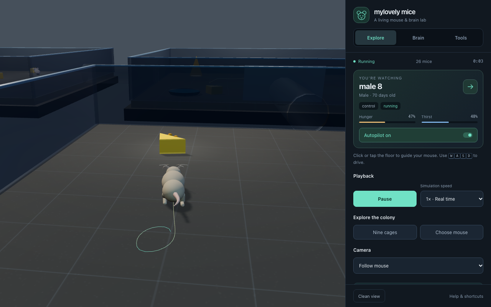

# mylovely-mice

Nine cages of mice, each under different conditions, every animal wired to a
running model of its own brain — and tunnels you can open between them.

You drive one of them. Every step, turn, sniff, drink, fight and encounter is
fed into ~700 model neurons spread across 38 real anatomical regions, and the
panels show what those neurons do while it happens. The nine cages hold a
control, one with no water, one with almost no food, one too bright, one that
smells of fox, one that startles them, one of males with nowhere to go, one
overcrowded and one with plenty of everything. Open the tunnels and the colony
redistributes itself — and the hippocampus of every animal that crosses builds
a new map for the cage it has arrived in.



## Running it

ES modules and `fetch()` do not work from a `file://` path, so serve the folder:

```bash
cd mylovely-mice
python3 -m http.server 8000
# open http://localhost:8000
```

Three.js and its controls are included in `vendor/`. All runtime files are
served by the site itself, with no CDN dependency and no backend to keep running.

The default view is the platform and right sidebar. Controls live in the sidebar,
with **Live stats** collapsed below them. Floating panels, status badges, the
scale bar and bottom charts start hidden; the introduction opens with **?**.
Use **panels → clean view** to restore this layout, or enable individual panels.
The browser remembers your choices.

### On GitHub Pages

Live site: **https://kammmran.github.io/mylovely-mice/**

GitHub Pages hosts the site continuously, including when your computer is off.
Each visitor runs their own simulation in their browser; it does not keep
simulating after that browser tab closes.

[`.github/workflows/deploy.yml`](.github/workflows/deploy.yml) runs the checks and
browser smoke test before publishing every push to `main`. You can also run it
from **Actions → deploy to github pages → Run workflow**. A failed check leaves
the previous successful deployment live.

Pages is already enabled for this repository. For a new fork, select
**Settings → Pages → Build and deployment → Source: GitHub Actions** once.
No hosting server, secrets, or scheduled keep-alive jobs are needed.

[`.github/scripts/package-site.mjs`](.github/scripts/package-site.mjs) stages
`index.html`, `src/`, `data/`, `vendor/` and `.nojekyll` in `dist/`. Only those
public runtime files are uploaded.

Every path in the page is relative, so it works from the `/mylovely-mice/`
subpath without configuration.

[`.github/workflows/ci.yml`](.github/workflows/ci.yml) is called by deployment on
every push to `main`, and also runs on pull requests. It checks the things that
would otherwise only show up as a blank page: that every module parses, that
every relative import points at a file that exists, that the data files parse,
and that `index.html` and its import map reference local files in the repository.
The browser test serves the staged site at `/mylovely-mice/`, blocks external
requests, verifies that the simulation runs, and checks the clean default,
panel toggles, saved preferences and narrow-screen layout.

## Controls

| key | |
|---|---|
| `W` `S` / `↑` `↓` | forward / back |
| `A` `D` / `←` `→` | turn |
| `shift` | run |
| `space` | sniff, rear up |
| `X` | watch the next mouse (or click one in the colony panel, or click its cage) |
| `O` | take the keys off the autopilot, and give them back |
| `.` `,` | run faster (1× 2× 4× 8×) / back to real time |
| `C` | camera: follow → orbit → overhead |
| `V` | learned-value overlay on the floor |
| `T` | path trail |
| `M` | rotate the cue card 90° |
| `[` `]` | arena light |
| `-` `=` | water level |
| `B` | the signals panel |
| `G` | the optogenetics rig |
| `1`–`6` | frighten them: cat call, owl swoop, noise burst, fox odour, cat collar, rotten smell |
| `0` | take the odour source away |
| `N` | fighting & mortality |
| `J` | the nine cages panel |
| `Y` | the session report |
| `K` | open or shut the tunnels between them |
| click the floor | send it there — it goes, then carries on foraging |
| click a pup | lift it; click again to set it down |
| `P` `R` `H` | pause, reset, hide help |

**Every mouse forages for itself.** Selecting one with `X`, or by clicking it in
the panel, means you are now *watching* that one — it keeps its autopilot. Press
`O`, or touch `W`/`A`/`S`/`D`, and the keys are yours; press `O` again to hand it
back. Clicking the floor sends it to that spot and then lets it get on with
whatever it was doing.

**Running faster.** `.` cycles 1× → 2× → 4× → 8×. The simulation takes more
steps per frame rather than longer ones — every integrator in here, from
Poisson spiking to the 1 kHz field potential to theta phase, is only valid at a
sane step length, and stretching it would quietly distort all of them. At 8× a
simulated day takes 0.6 s, so a pregnancy runs in about twelve seconds and a
mouse can die of old age while you watch.

The colony panel also carries the three drive switches. Turning one off silences
that circuit and removes the behaviour: with **mating** off, libido stays at zero,
MPN and VMHvl go quiet and no mating can occur.

## What is actually real

**The anatomy is real.** `data/mouse_brain_ccf.json` is built from the Allen
Mouse Brain Common Coordinate Framework v3 (CCF 2017) structure meshes, pulled
from the Allen Institute's own download server and decimated for real-time
rendering. Region names, structure ids and colours come from the Allen structure
graph API. The brain you rotate is a real mouse brain.

**The wiring between regions is real too.** `data/mouse_connectivity.json` is
built from the Allen Mouse Brain Connectivity Atlas (Oh et al. 2014): every number
is a measured anterograde tracer projection — an rAAV-EGFP injection into one
structure and the fluorescence found in another — averaged over every experiment
whose primary injection site was that source, for all 38 modelled regions. The
populations are wired to each other with those strengths, so activity spreads the
way it anatomically can and not otherwise. The numbers come out as the textbooks
describe: CA3 to CA1 is by far the strongest hippocampal link (the Schaffer
collateral, 19.0), the dentate feeds CA3 (3.99, mossy fibres), entorhinal cortex
feeds CA1 and dentate (the perforant path), LGd to V1 dominates visual input
(10.0), and motor and sensory cortex both pour into the striatum (9.1 and 4.3).
Select any region and the panel shows its strongest measured inputs and outputs.

Tracer data says an axon arrives, not what it does on arrival, so the model adds
the one thing the anatomy cannot: the striatal and extended-amygdala outputs
(CP, ACB, CEA, BST) are treated as inhibitory, because those are GABAergic
projection neurons, and the dopamine cells as modulatory rather than driving.

**Real recorded firing rates are shipped for comparison.**
`data/mouse_unit_metrics.json` summarises **99,120 sorted neurons** from the Allen
Brain Observatory Neuropixels survey (Siegle et al. 2021): median firing rate,
interquartile range and fast-spiking fraction for 47 structures, seven of which
this model simulates. The signals panel draws the model's current rate directly
against the recorded distribution for whichever region you have selected, so you
can see for yourself where it agrees. Measured CA1 median is 2.87 Hz across 17,104
recorded units; the model sits around 2.2-2.7 Hz while foraging.

**The physiology is reproduced, not replayed.** No spike trains are played back.
Each population has a tuning curve built to match the published response
properties of that cell type, is driven by the simulated animal's own state, and
emits Poisson spikes. What that buys you is that the panels show real phenomena
rather than decoration:

| what you can watch | reproduces |
|---|---|
| CA1 place fields building up in the rate map as you explore | O'Keefe & Dostrovsky 1971 |
| Spikes advancing in theta phase across a field | O'Keefe & Recce 1993 |
| MEC grid cells in three modules, spacing ×1.42 apart | Hafting 2005; Stensola 2012 |
| Theta climbing 6.7 → 12 Hz with running speed | Rivas 1996; Wells 2013 |
| Head-direction tuning, with the AD cells leading POST by ~50 ms | Taube 1990; Blair & Sharp 1995 |
| The compass rotating when you move the cue card (`M`) | Taube 1990 |
| Sharp-wave ripples replaying the path backwards after a reward | Foster & Wilson 2006 |
| A dopamine burst that shrinks as the cheese becomes predictable | Schultz 1997 |
| AgRP hunger neurons switching off *before* the first bite | Betley 2015; Chen 2015 |
| SFO thirst neurons switching off on reaching water | Oka 2015; Zimmerman 2016 |
| BNST responding more strongly in the male than the female | Bayless 2019 |
| MPN driving male courtship, VMHvl female receptivity | Wei 2018; Lin 2011 |
| SCN firing tracking arena light, and bright light raising CEA/PAG/PVH | Meijer 2003; Fuzesi 2016 |
| Pups calling ultrasonically out of the nest, and the mother fetching them | Ehret 2005; Hofer & Shair 1978 |
| MPOA galanin neurons driving retrieval, oxytocin rising while nursing | Wu 2014; Kohl 2018; Marlin 2015 |
| Stimulating VMHvl: mounting at low power, attack at high power | Lin et al. 2011 |
| Freezing to a cat call, and the 4 Hz rhythm that replaces theta while it lasts | Blanchard 1989; Moberly 2018; Bagur 2021 |
| Escape to the wall within ~250 ms of a shadow expanding overhead | Yilmaz & Meister 2013 |
| A startle that halves with repetition and comes back after a quiet minute | Koch 1999; Davis 1980 |
| Avoiding the corner that smells of fox, from the first exposure, without habituating | Fendt 2005 |
| Cat odour read by the vomeronasal organ: AOB to MeA to VMHdm | Papes 2010; Canteras 2002 |
| A rotten smell avoided just as strongly, with no freezing and no defensive circuit | Kobayakawa 2007 |
| A resident attacking a strange male and tolerating a cagemate | NC3Rs; Mertens 2019 |
| Virgin males killing pups, and stopping once they have mated | vom Saal & Howard 1982 |
| cMPOA and BSTrh, a millimetre apart, carrying paternal and infanticidal states | Tsuneoka 2015 |
| Pups chilling out of the nest, and the dam eating the body afterwards | Lagerspetz 1966; Weber & Olsson 2008 |
| Mortality doubling every 100 days, for a median lifespan near 900 | Mouse Phenome Database |
| Animals piling into the most-connected pen once the pens are connected | Calhoun 1962 |
| A separate hippocampal map per cage, switching at the tunnel and coming back on return | Muller & Kubie 1987; Leutgeb 2005 |
| Grid modules keeping their spacing across the move while place cells remap | Fyhn et al. 2007 |
| Driving CA3 raises CA1 through the Schaffer collateral, and only CA1 | Allen Connectivity Atlas |

Full per-region descriptions and citations are in
[`src/neuro/regions.js`](src/neuro/regions.js).

**The body is measured too.** Segment lengths, joint ranges of motion, the gait
repertoire, whisking and breathing rates all come from published measurements,
cited per value in [`src/world/mousedata.js`](src/world/mousedata.js) and mirrored
in [`data/mouse_biometrics.json`](data/mouse_biometrics.json). See
[`docs/biomechanics.md`](docs/biomechanics.md).

**Deliberate compressions.** The oestrous cycle really lasts 4–5 days; here it is
75 s so you can watch it turn over. Hunger, thirst and libido build in minutes
rather than hours. These are labelled where they appear.

## Breeding

Mate the two mice and the female can conceive. From there it plays out properly:

- **Gestation** runs 19.5 days, with her hunger climbing as the litter grows. The
  colony panel tracks the days, and oestrous cycling stops while she is pregnant.
- **Birth** produces 5-8 pups in a nest she sites against a wall. They are
  altricial - pink, naked, blind, deaf and unable to walk, which is what newborn
  mice actually are.
- **They develop**: fur from day 3, eyes open at day 13, weaned at day 21.
- **Pup retrieval.** Take a pup out of the nest - click it, then click where to put
  it down. Out in the cold it starts calling at 40-90 kHz; you will see the mother's
  auditory cortex respond, her MPOA galanin neurons rise, and then she walks over,
  picks the pup up in her mouth, carries it back and drops it in the nest. This is
  the standard laboratory assay for maternal behaviour, and it works here for the
  same reason it works in a real mouse.
- **Nursing** over the litter drives the oxytocin neurons of the PVH.
- She is fertile again within a day of giving birth - mice have a postpartum oestrus.

**The pups grow up.** At weaning each one becomes a mouse of its own, with its own
brain, its own name and its own colouring — it joins the colony as a juvenile at
45% of adult size, grows over the next three weeks, and reaches sexual maturity at
six weeks, at which point it can breed in turn. Juveniles are marked with their age
in the colony panel; adults are not. Press `X` to take control of any of them, or
click one in the panel.

The cage holds **100**. Past that, weaned juveniles disperse rather than joining.

Holding a hundred animals needs level of detail, because the honest version does
not fit in a frame:

- **Bodies.** The articulated rig is 64 meshes, so a hundred of them is 6,400 draw
  calls. Only the six animals nearest the camera get a rig; the rest run the same
  locomotion on a stripped body ([`src/world/proxybody.js`](src/world/proxybody.js))
  and are drawn as one instanced mesh. Agents are swapped between the two as the
  camera moves, carrying their locomotion state across, so you never see it happen.
- **Brains.** Every animal keeps its own brain, but at three levels of detail: full
  for the one you are driving (spike trains, rate maps, 1 kHz field potential),
  lighter for the rigged few, and drives-only for the rest. Animals nobody is
  inspecting think at 20 Hz rather than 60.
- **Measured** with a full colony of 100: **2.97 ms of CPU per frame** and 161-430
  draw calls, against 17.8 ms and 6,400 for the naive version.

One simulated day is five seconds, so a pregnancy takes about a minute and a half
and a pup reaches adulthood about three and a half minutes after it is born.

## Signals

Press `B`. Everything in this panel is computed live from the simulated local
field potential, which is generated at **1 kHz** — a frame-rate signal could not
represent anything above about 30 Hz, so gamma and ripples would be invisible.

- **Spectrum**, 1&ndash;250 Hz on a log axis, with the standard bands shaded. The
  theta peak tracks running speed in front of you.
- **Band power** for delta, theta, beta, slow gamma, fast gamma and ripple, on a
  dB scale because theta outweighs everything else while the mouse runs. Stop
  moving and watch delta and the ripple band take over.
- **Theta&ndash;gamma coupling**, as Tort's modulation index, with slow-gamma
  amplitude binned by theta phase over two cycles. Slow and fast gamma are
  generated at *different* theta phases, as they are in CA1 (Colgin et al. 2009),
  and the analysis recovers that from the signal rather than being told it.
- **Inter-spike intervals** for the selected region, with the coefficient of
  variation — around 0.8&ndash;1.0, the irregular, Poisson-like firing real
  cortical and hippocampal neurons show.
- **Model vs recorded**, described above.
- **Body**: heart rate, breathing, pupil diameter and arousal, in real mouse
  units (heart 500&ndash;740 bpm; quiet breathing 2&ndash;4 Hz rising to ~12 Hz
  while sniffing; pupil 0.5&ndash;2 mm, which tracks arousal).

## Frightening them

Press `1`–`6`, or use the **threats** panel. Six stimuli, each a standard
laboratory assay rather than an invention:

| | what it is | what they do about it |
|---|---|---|
| `1` cat call | a predator heard nearby, no escape route | freeze |
| `2` owl swoop | a screech and a dark disc expanding overhead | run for the wall |
| `3` noise burst | ~105 dB of white noise for 40 ms | startle, then a short freeze |
| `4` fox odour | trimethylthiazoline on filter paper, in the far corner | risk assessment, then avoidance |
| `5` cat collar | a collar a cat has worn, in the far corner | the same, through a different nose |
| `6` rotten smell | something decayed | avoidance, and nothing else |

**Which defence appears is not a free choice.** It follows how close the danger
is — Fanselow's predatory imminence continuum. A smell in the far corner is
*potential* danger, and produces risk assessment: the mouse stretches out
towards it, sniffs, holds station at about 30 cm and goes no closer. A predator
heard nearby is *post-encounter* danger, and produces freezing: immobile except
for breathing, for ten seconds or so, and no eating or courting while it lasts.
Something coming down on top of the animal is *circa-strike* danger, and
produces flight and nothing else until it is over. These run through different
columns of the same midbrain structure — the ventrolateral PAG for freezing, the
dorsolateral for flight — and because those columns inhibit each other, a mouse
never does both.

**Things worth watching while it happens:**

- **The hippocampus changes rhythm.** Theta stops and the LFP drops to a steady
  4 Hz, because a freezing mouse breathes at 4 Hz and that rhythm entrains the
  whole olfactory-limbic network. Sharp-wave ripples stop too: fear-induced
  immobility is not quiet rest.
- **Dopamine dips.** An aversive event is negative reinforcement, and the critic
  reads the same place code the value map does — so turn the value overlay on
  (`V`) and the corner with the fox odour in it loses its value.
- **Two smells, two circuits.** The cat collar drives AOB → MeA → VMHdm; the
  rotten smell drives the olfactory bulb just as hard and leaves VMHdm, the PAG
  and the central amygdala flat. Avoidance and fear are not the same thing, and
  the panels show the difference.
- **Sounds habituate, smells do not.** Press `3` five times in a row and watch
  the response shrink; the panel reports how much of the first response is left.
  Press `4` as often as you like and it is as strong as it was.
- **Fear is catching.** A mouse that can see its cagemate freeze freezes too.
- **Corticosterone lags.** The behaviour is over in seconds; the slow arm of the
  stress response is still elevated minutes later, which is what the second bar
  in the panel is tracking.
- **The measures are the ones an experimenter would report**: percentage of time
  spent freezing, and percentage of time spent in the quadrant the stimulus is
  in, where 25% is chance.

Turning the **defence** switch off in the colony panel silences the circuit:
the mice still hear the call and still smell the fox, and do nothing about
either — roughly what an animal with no working vomeronasal organ does when it
meets a cat.

## Nine cages

Press `J`. The colony is not one box but nine, in a 3×3 grid, each held under
different conditions and each with its own animals, its own litter and its own
brains. Press `C` until the camera says **all nine** to see the whole grid.

```
   no water      bright light    scarce food
   all male      CONTROL         well provisioned
   crowded       fox odour       intermittent noise
```

The control sits in the middle on purpose — see below. The others each isolate
one thing: a cage with no water dish at all, a cage with one piece of cheese
instead of three, a cage with the lights at full, a cage with fox odour in the
corner, a cage that fires a startling noise burst every twenty seconds, a cage
of four unrelated males with nowhere to get away from each other, a cage with
eight animals in it, and a cage with plenty of everything and the lights down.
Every panel, slider and hotkey acts on **the cage you are currently driving in**,
and clicking any cage in the grid takes control of an animal inside it.

Leave them shut and you have nine experiments running side by side: thirst and
dehydration in one, AgRP firing and foraging in another, thigmotaxis under
bright light, avoidance of the fox corner, startle habituation, a dominance
order forming among the four males.

**Then press `K` and open the tunnels.**

### What happens then

**It becomes Calhoun's experiment.** In 1962 he connected pens with ramps and
found that the animals stopped distributing themselves evenly: because the end
pens had one connection and the middle pens two, they piled into the middle —
the *behavioural sink* — and the pathology that followed came from that
aggregation rather than from any shortage. A 3×3 grid has the same geometry for
free: the corners have two tunnels, the edges three, and the centre four. The
panel tracks the share of the colony in the busiest cage, against the 11% an
even split would give. The centre is the control cage precisely so that
crowding there is about connectivity and not about what is in it.

**Before that, the conditions drive the traffic.** A thirsty mouse in the cage
with no dish will now leave it, because water is the drive that moves a mouse
first — days without it against weeks without food. Hunger moves them out of
the one-cheese cage. Fear moves them out of the fox-odour cage. The event feed
names the reason each time an animal goes through.

**And the hippocampus remaps.** A place cell does not carry one map around: it
has a separate, independent map for every environment it knows. Cross a tunnel
and watch the rate map in the panel start again from nothing — that is the new
cage's map being built. Go back and the first map comes back intact. Grid cells
behave differently, as they do in a real animal: the module shifts and rotates
but keeps its spacing, so the metric survives the move. Head-direction cells do
not remap at all, which is what lets an animal know which way it is facing in a
cage it has never been in. The feed reports which of the nine maps the animal
has just switched to.

## Dying

Press `N`, or the **mortality** button. Mice in this colony can be killed and
can die of their own accord, and every way they can is something that happens
to real mice.

| cause | how it happens here |
|---|---|
| fight wounds | a male bites another male on the rump; a sustained attack on an animal that cannot escape is fatal |
| infected wounds | the usual way fighting kills — days after the fight, not during it |
| killed by a male | a male who has not mated kills pups he finds |
| chilled out of the nest | a pup away from the nest cools and dies |
| dehydration | days at maximum thirst with no water it can reach |
| starvation | the same, over weeks rather than days |
| drowned | a flooded arena with nowhere to climb out |
| old age | mortality doubling every 100 days, median near 900 |

**A fight is a sequence, not a switch.** Males tail-rattle first, then chase,
then bite, and the bites land on the rump and the base of the tail — which is
why a wounded cage mouse is nearly always wounded there. The encounter
escalates the longer the two stay nose to nose, and it resolves into a
dominance order: once an animal has lost a few exchanges it submits and keeps
out of the way. Deaths come from the cases where that cannot happen, which is
also when they happen in a real facility: nowhere to retreat to, and a
dominant animal that keeps coming.

**The resident-intruder test** is one button. Put an unfamiliar male into an
established cage and the resident attacks him; a cagemate of the same age and
sex is tolerated. Familiarity builds over about a minute here, so the fight is
in the first few seconds. The resident usually wins, because he is the
resident.

**Infanticide, and the switch out of it.** A virgin male kills pups. A male
that has mated does not: the inhibition appears a few days after he mates, is
in place before his own offspring would be born at 18-20 days, and lifts again
50-60 days later — a clock that runs without any hormonal or social cue.
Two nuclei a millimetre apart read out which state he is in, and the model has
both: **cMPOA** activity means paternal, **BSTrh** means infanticidal, and the
cMPOA holds the BSTrh down through a GABAergic projection. Lesion the cMPOA in
a real mouse and a father starts killing pups; lesion the BSTrh and a virgin
male stops. Watch BSTrh in the raster while a virgin male walks up to a pup,
then mate him and watch it go quiet.

**What usually kills pups is not that.** Researchers who filmed dams losing
whole litters found no evidence of pups being killed, and concluded that
females mostly eat pups that had already died — of cold, out of the nest,
because a mouse cannot thermoregulate at all before about day 18. So what you
will mostly see here is a pup chilling while nobody fetches it, and the mother
eating the body afterwards. That is cannibalism of a dead pup, not infanticide,
and the distinction is the current argument in the literature rather than a
detail. A chilling pup calls louder as it cools and then goes quiet as it goes
torpid, so a silent pup is in more trouble than a screaming one.

Two switches in the panel: **fights can kill** holds the loser above the point
of recovery without stopping the fighting, and **infanticide** turns pup-killing
off entirely. Body condition appears as a fourth bar in the colony panel, and
an animal that cannot find water loses weight visibly before it dies — 20%
below baseline is the endpoint, which is the number a facility actually uses.

## Optogenetics

Press `G` for a virtual optogenetics rig: express an opsin in any modelled region,
shine light on it, and watch behaviour change. The headline demonstration is VMHvl,
where the same neurons do different things at different drive levels:

| light power | mating drive | aggression |
|---|---|---|
| 1.2 mW | 0.70 | 0.17 |
| 12 mW | 0.12 | 0.86 |

At low power the male mounts; at high power he attacks and the other mouse flees.
That crossover is the Lin et al. 2011 result. Each animal is implanted separately,
so stimulating one leaves the other at baseline.

## Layout

```
index.html              page, layout, styling
src/main.js             the loop: steps both mice and their brains, drives every panel
src/neuro/brain.js      the model — populations, tuning curves, drives, TD learning, replay
src/neuro/regions.js    what each region does, and the work it is based on
src/world/arena.js      open field, cheese, water dish, floodable water, lighting
src/world/mouse.js      the mouse rig: articulated body, gait, whisking, autopilot
src/world/mousedata.js  every physical constant, with units and citations
src/world/pups.js       the litter: nest, altricial pups, growth, ultrasonic calls
src/world/threats.js    predator calls, looming shadows, aversive odours
src/world/mortality.js  fighting, infanticide, and the causes of death
src/world/colonygrid.js nine cages, their conditions, and the tunnels between
src/report.js           the session report, its findings, and the downloads
src/pdf.js              a small dependency-free PDF writer, for the long form
src/optogenetics.js     opsins, implants, light, region-to-behaviour mapping
src/view/brainview.js   3-D Allen CCF brain, lit by live firing rate
src/view/plots.js       spike raster, LFP and dopamine traces, rate maps, polar tuning
src/view/palette.js     colour parameters (validated for contrast and colour-blindness)
data/mouse_brain_ccf.json    39 decimated Allen CCFv3 structure meshes
data/mouse_connectivity.json real tracer projection strengths between them
data/mouse_unit_metrics.json firing statistics of 99,120 recorded neurons
src/neuro/signals.js         FFT, Hilbert, band power, phase-amplitude coupling
src/view/signalspanel.js     the electrophysiology panel
```

## Showing and hiding panels

Every panel can be turned off. The **panels** button in the toolbar lists them all,
grouped by where they live:

- **layout** — the whole side panel
- **side panel** — the brain, busiest right now, about this region, the tuning
  maps, all 37 regions
- **along the bottom** — spike raster, brain waves, reward traces
- **over the arena** — the colony, what just happened, threats, keys

The layout closes up around whatever you hide: drop the spike raster and the
traces widen to fill the bottom; hide both and the bottom strip disappears
entirely; hide the side panel and the arena takes the whole window. **arena only**
clears everything at once for an unobstructed view, and **show all** brings it
back. Clicking any card's title rolls it up without removing it. Your choices are
remembered between visits.

## Finding your way around

The first time you open it you get a short explainer; the **?** button brings it
back. Beyond that:

- **Click the floor** and the mouse walks there — you never have to touch the
  keyboard if you would rather not.
- **"What just happened"**, bottom left, narrates events in plain language as they
  occur: a dopamine burst when cheese is found, a replay when the mouse stops, the
  female entering oestrus.
- **"Busiest right now"** ranks the five most active regions live, each with a plain
  description ("place cells — where am I"), so you can see what is driving behaviour
  without knowing the acronyms. Click any of them for the full account.
- The complete 37-region list is folded away under **all 37 regions**, and can be
  filtered to one system at a time.

## Reading the panels

- **Spike raster** — one row per sampled neuron, grouped into labelled bands by
  system. Scrolls right to left over a 30 s window; the ruler marks every second
  and brightens every fifth, so intervals can be read off it. Each band is also
  named, so colour is never the only cue. Rows are ordered by what the cells are
  tuned to, which is what makes the bands readable: CA1 and CA3 by field
  position along `+x`, so crossing the arena sweeps the band diagonally; ENTm as
  three blocks, one per grid module (30 / 43 / 60 cm), so the spacing ratio
  shows up as three rates of striping over one run; POST by preferred direction,
  so the head-direction bump walks down the band as the mouse turns; SUB as four
  blocks, one per wall.
- **Spatial tuning** — occupancy-normalised rate maps, accumulated from the
  spikes as you explore, the way an experimentalist would build them. Click a
  card to switch cells. Maps use `+z` up and `+x` left to match the overhead
  camera.
- **Hippocampal LFP** — theta with nested gamma; the pink bands are sharp-wave
  ripples, which only fire when the mouse holds still.
- **Dopamine** — VTA firing rate on top, the learned value V(s) below, on a
  shared time axis.
- **Colony** — both animals' drives side by side, with the environment sliders
  and the three drive switches.

## The report

Press `Y`. It answers "what actually happened in there", in three parts.

**What is interesting** comes first, and it is generated rather than written.
A set of rules each look for one pattern in the session and, if it is there,
say so with the number in it and the work it reproduces — the share of the
colony that has ended up in the most-connected cage against the 11% an even
split would give; which cages emptied and why; how many hippocampal maps the
colony is now holding; who is doing the biting and who is taking it; whether
pups were lost to cold or to a male; which males have switched out of
infanticide and which have not. A rule that finds nothing says nothing, so the
report only ever describes what this particular run did.

**Every mouse** is a table: where it lives, where it has been, how old it is,
what it has eaten and drunk, how often it has mated, bites given and taken,
body condition, tunnel crossings, how many separate maps its hippocampus is
carrying, and how it died if it did. Underneath that is the whole timeline,
not just the last few lines the feed keeps.

**The PDF is the long form.** Markdown and CSV give you the tables; the PDF
gives you every animal in full — age, cage history and tunnel crossings, body
condition and weight loss, everything it has eaten, drunk and mated, bites
given and taken, dominance, hunger, thirst, libido, oestrus or paternal state,
fear and corticosterone, freezing and avoidance, the hippocampal maps it is
carrying, its theta frequency and dopamine rate and learned value — and then a
firing rate for **every one of the 38 modelled regions in that animal's brain**
at the moment the report was taken, followed by that animal's own timeline.
For a full colony that is thirty-odd pages.

It downloads as **PDF**, as **Markdown** — the thing you would send someone —
or as **CSV**, one row per animal, for anything that wants a spreadsheet. The
copy button puts the Markdown on the clipboard. The PDF is generated in the
browser with no library: [`src/pdf.js`](src/pdf.js) writes the file itself,
because a document that only needs the standard fonts does not need any of a
PDF library, and this project has no build step to add one to.

## Caveats

This is a teaching and exploration tool, not a simulator you should draw
scientific conclusions from. The populations are small, the tuning curves are
analytic rather than fitted to data, and the circuits are modelled as
feed-forward drives rather than as interacting networks.
